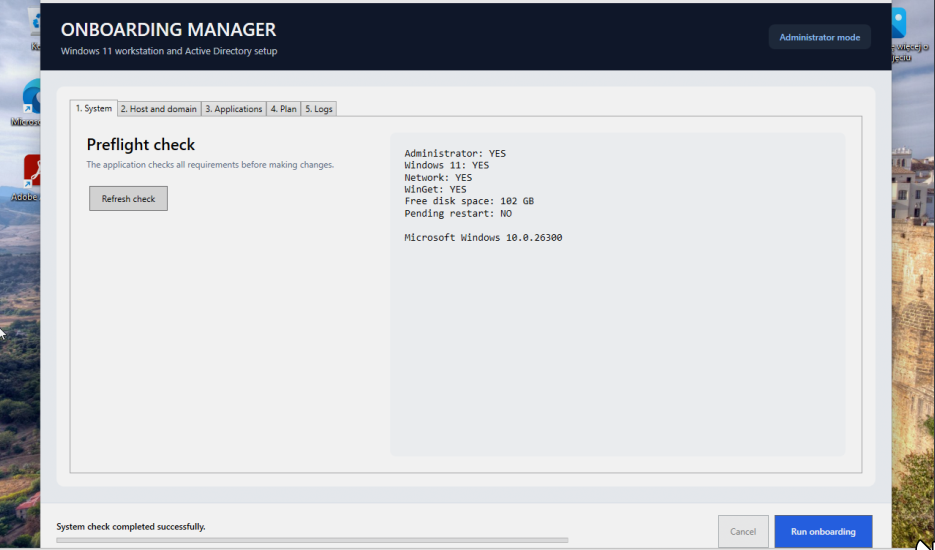
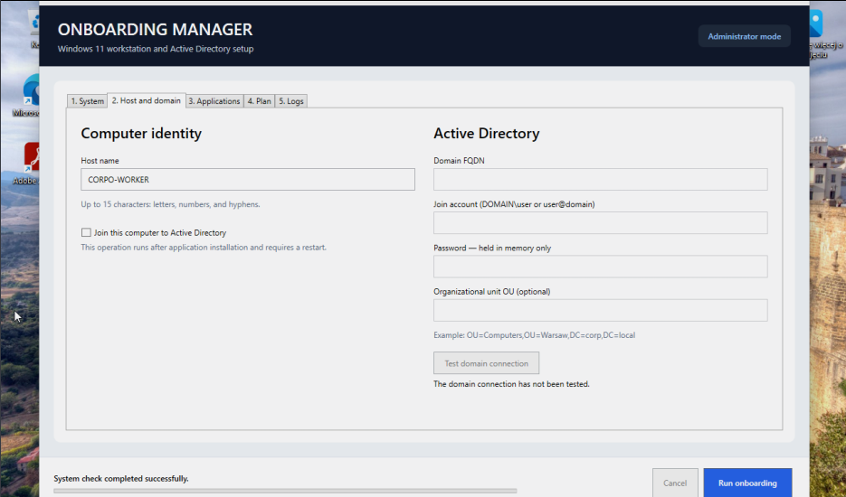
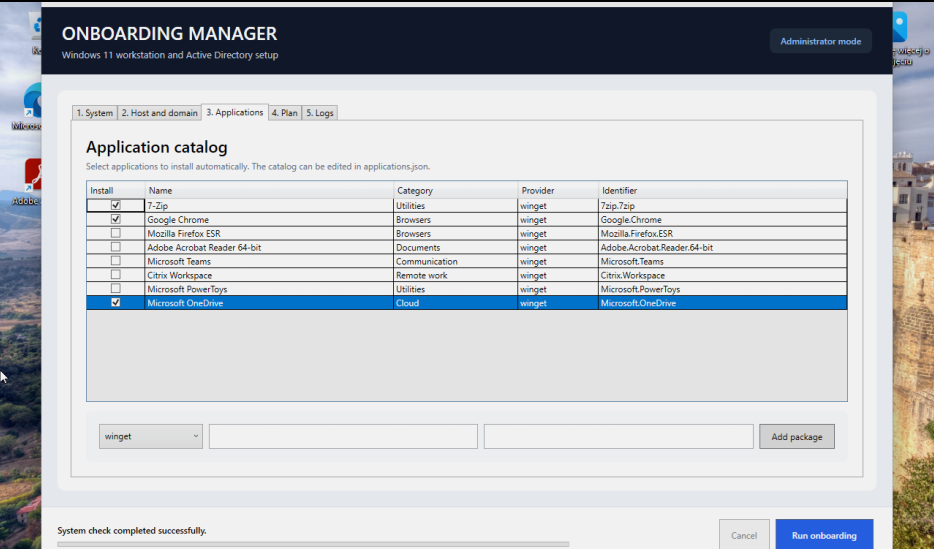
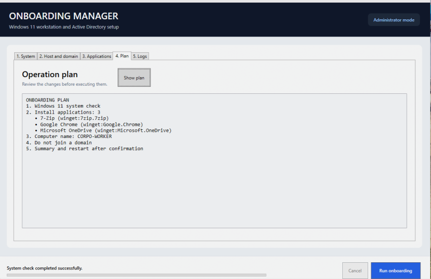

# Onboarding Manager

<p align="center">
  
  
  
  
  
  
</p>

**Onboarding Manager** is a Windows 11 desktop application for preparing a new workstation, installing an approved application set, assigning a computer name, and optionally joining an on-premises Active Directory domain.

The application provides a guided graphical workflow for IT technicians. It performs preflight checks, validates operator input, installs packages sequentially, records a persistent execution log, and reports operations that require a restart.

> [!IMPORTANT]
> This repository currently contains an MVP. Test it on a disposable Windows 11 VM and take a snapshot before using it against a production Active Directory environment.

## Table of Contents

- [Features](#features)
- [Screenshots](#screenshots)
- [Workflow](#workflow)
- [Requirements](#requirements)
- [Quick Start](#quick-start)
- [Operator Guide](#operator-guide)
- [Active Directory](#active-directory)
- [Application Catalog](#application-catalog)
- [Architecture](#architecture)
- [Build and Publish](#build-and-publish)
- [Logs and Exit Codes](#logs-and-exit-codes)
- [Security](#security)
- [Troubleshooting](#troubleshooting)
- [Project Structure](#project-structure)
- [Current Limitations](#current-limitations)
- [Recommended Production Improvements](#recommended-production-improvements)

## Features

- **Windows 11 preflight check** for:
  - administrator privileges;
  - supported Windows build;
  - network availability;
  - WinGet availability;
  - free system drive space;
  - pending restart indicators.
- **Computer name management** with NetBIOS-compatible validation.
- **Optional Active Directory join** using:
  - domain FQDN;
  - delegated domain account;
  - password field;
  - optional Organizational Unit distinguished name.
- **Domain controller discovery** through `nltest.exe`.
- **Application catalog** loaded from an editable JSON file.
- **WinGet and Chocolatey providers**.
- **Custom package entry** during the current application session.
- **Dry-run operation plan** before execution.
- **Sequential package installation** with per-package results.
- **Cancellation support** for the active onboarding run.
- **Persistent log file** under `C:\ProgramData\OnboardingManager\Logs`.
- **Self-contained Windows x64 build**, so the target machine does not need a separate .NET runtime installation.
- **English user interface** and execution messages.

## Screenshots

### System preflight

The System tab verifies the workstation before any changes are made.

<p align="center">
  <a href="img/start.png">
    
  </a>
</p>

### Computer identity and Active Directory

The Host and domain tab controls the target computer name and the optional on-premises AD join.

<p align="center">
  <a href="img/identity.png">
    
  </a>
</p>

### Application catalog

Applications can be selected from the catalog or added by package identifier for the current run.

<p align="center">
  <a href="img/application.png">
    
  </a>
</p>

### Operation plan

The Plan tab summarizes package installation, the target host name, and the domain action before execution.

<p align="center">
  <a href="img/Plan.png">
    
  </a>
</p>

## Workflow

Onboarding Manager executes operations in this order:

1. Run the system preflight check.
2. Validate all form fields.
3. Verify that every selected package provider is available.
4. Install selected applications sequentially.
5. Continue past individual package failures and collect their results.
6. If domain join is enabled:
   1. discover a domain controller;
   2. rename the computer and join it to AD with one `Add-Computer` operation;
   3. optionally place the computer object in the specified OU.
7. If domain join is disabled, rename the local computer only when the requested name differs from the current name.
8. Display the final result and report whether a restart is required.

The application does not automatically restart the workstation. The technician remains in control of the restart.

## Requirements

### Target workstation

- Windows 11 x64, build 22000 or newer.
- At least 10 GB free on the system drive.
- Local administrator rights.
- Network connectivity.
- WinGet for WinGet-based packages.
- Chocolatey already installed when Chocolatey packages are selected.

### Active Directory join

- Direct connectivity to the corporate network.
- Corporate DNS configured on the Windows network adapter.
- Network access to a writable domain controller.
- An AD account with delegated permission to create or reuse computer objects in the target OU.
- Correct system date and time.

Do not use a Domain Admin account for routine onboarding. Delegate only the permissions required for the workstation OU.

## Quick Start

### Use the prepared package

1. Download `OnboardingManager-win-x64.zip` from the
   [latest GitHub release](https://github.com/dj-kolkol2002/Autoinstalator_Onboarding/releases/latest).

2. Extract the archive on the Windows 11 workstation.
3. Keep these items together:

   ```text
   OnboardingManager.exe
   Catalog/
   └── applications.json
   ```

4. Run `OnboardingManager.exe`.
5. Approve the Windows UAC prompt.
6. Complete the tabs from left to right.
7. Review the operation plan.
8. Select **Run onboarding**.

### Virtual machine testing

Before testing:

1. create a VM snapshot;
2. use a bridged or corporate VLAN network when testing an AD join;
3. configure the VM to use the AD DNS server;
4. verify domain discovery with:

   ```powershell
   nltest /dsgetdc:corp.example.com
   ```

## Operator Guide

### 1. System

Select **Refresh check** and review:

| Check | Expected value | Meaning |
| --- | --- | --- |
| Administrator | `YES` | The application has elevated privileges |
| Windows 11 | `YES` | The operating system build is supported |
| Network | `YES` | Windows reports an active network |
| WinGet | `YES` when required | WinGet is available in the executable path |
| Free disk space | 10 GB or more | Minimum space required by the preflight policy |
| Pending restart | Preferably `NO` | Windows does not report an unfinished restart |

A pending restart is displayed as a warning indicator but does not currently block execution.

### 2. Host and domain

Enter the target host name. The current validator requires:

- 1 to 15 characters;
- letters, numbers, and hyphens only;
- no leading or trailing hyphen;
- at least one non-numeric character.

Examples:

- `CORP-LT-001`
- `WAW-FIN-023`
- `TEST-VM01`

To configure a workgroup-only test machine, clear **Join this computer to Active Directory**. Domain fields will be disabled and the application will only rename the host if required.

### 3. Applications

- Select each application to install.
- Confirm the provider and exact package identifier.
- To add a package for the current session:
  1. select `winget` or `chocolatey`;
  2. enter the package identifier;
  3. enter a friendly display name;
  4. select **Add package**.

Packages added in the UI are not written back to `applications.json`; they exist only for the current session.

### 4. Plan

Select **Show plan**. Review:

- the number and names of selected applications;
- the package provider and identifier;
- the target computer name;
- whether the workstation will join a domain;
- the target OU when provided.

### 5. Logs

The Logs tab shows output collected during the current session. The persistent log file path is displayed above the log viewer.

## Active Directory

### Domain fields

| Field | Example | Required |
| --- | --- | --- |
| Domain FQDN | `corp.example.com` | Yes when domain join is enabled |
| Join account | `CORP\join-user` or `join-user@corp.example.com` | Yes |
| Password | Account password | Yes |
| OU | `OU=Workstations,OU=Warsaw,DC=corp,DC=example,DC=com` | No |

The domain validator expects a multi-label FQDN. Single-label domain names are not accepted.

### Connection test

**Test domain connection** invokes:

```text
nltest.exe /dsgetdc:<domain> /force
```

This confirms that Windows can discover a domain controller. It does not validate the supplied account password.

### Join operation

The application starts Windows PowerShell without a user profile and executes `Add-Computer` with:

- `DomainName`;
- `Credential`;
- `NewName`;
- optional `OUPath`;
- `Force`;
- `PassThru`.

The join operation does not use the `-Restart` switch. On success, the application reports that a restart is required.

## Application Catalog

The catalog is located at:

```text
src/OnboardingManager/Catalog/applications.json
```

The published copy is located next to the executable:

```text
Catalog/applications.json
```

### Entry format

```json
{
  "name": "VLC media player",
  "packageId": "VideoLAN.VLC",
  "provider": "winget",
  "category": "Multimedia",
  "scope": "machine",
  "isSelected": false
}
```

| Property | Description |
| --- | --- |
| `name` | Display name shown in the UI |
| `packageId` | Exact package identifier used by the provider |
| `provider` | `winget`, `chocolatey`, or `choco` |
| `category` | Display category |
| `scope` | `machine` or `user`; used by WinGet |
| `isSelected` | Default checkbox state |

### WinGet execution

WinGet packages are installed with an exact identifier, silent mode, the community WinGet source, non-interactive mode, and accepted source/package agreements.

Validate an identifier before adding it:

```powershell
winget search --id VideoLAN.VLC --exact
```

### Chocolatey execution

Chocolatey packages use:

```text
choco install <package-id> --yes --no-progress
```

Onboarding Manager does not bootstrap Chocolatey automatically. Install and approve Chocolatey separately before selecting this provider.

## Architecture

| Component | Responsibility |
| --- | --- |
| `MainWindow.xaml` | WPF user interface and navigation tabs |
| `MainViewModel` | UI state, plan generation, validation flow, and orchestration |
| `PreflightService` | OS, privilege, network, disk, WinGet, and restart checks |
| `PackageInstallerService` | WinGet and Chocolatey command construction and results |
| `ActiveDirectoryService` | Domain discovery, computer rename, and AD join |
| `ProcessRunner` | Safe process argument handling, output capture, and cancellation |
| `ApplicationCatalogService` | JSON catalog loading |
| `InputValidator` | Host name, domain, OU, and package identifier validation |
| `AppLog` | Persistent timestamped log files |

### Execution model

The current application requests administrator privileges through its Windows manifest:

```xml
<requestedExecutionLevel level="requireAdministrator" uiAccess="false" />
```

This means the complete WPF process runs elevated after UAC approval. A future production version should separate the standard-user UI from a small privileged worker.

## Build and Publish

### Development requirements

- .NET 8 SDK.
- Windows Desktop SDK support.
- Windows 11 is recommended for running and testing the WPF application.

### Build

```powershell
dotnet build .\src\OnboardingManager\OnboardingManager.csproj -c Release
```

### Publish a self-contained x64 build

```powershell
dotnet publish .\src\OnboardingManager\OnboardingManager.csproj `
  -c Release `
  -r win-x64 `
  --self-contained true `
  -p:PublishSingleFile=true `
  -p:IncludeNativeLibrariesForSelfExtract=true `
  -o .\artifacts\win-x64
```

The editable `Catalog/applications.json` file remains external by design.

### Create a distribution archive

```powershell
Compress-Archive `
  -Path .\artifacts\win-x64\OnboardingManager.exe, .\artifacts\win-x64\Catalog `
  -DestinationPath .\artifacts\OnboardingManager-win-x64.zip `
  -Force
```

## Logs and Exit Codes

Logs are written to:

```text
C:\ProgramData\OnboardingManager\Logs\onboarding-YYYYMMDD-HHMMSS.log
```

The application:

- treats exit code `0` as success;
- treats `1641` and `3010` as success requiring a restart;
- records other exit codes as installation failures;
- continues to the next package after an individual package failure;
- stops the main workflow when preflight, provider validation, or domain discovery cannot continue safely.

Cancelling onboarding terminates the active child process tree.

## Security

- The application must be run only from a trusted, access-controlled directory.
- The current EXE is not code-signed.
- The domain password is not saved to disk, written to logs, or passed in command-line arguments.
- The password exists temporarily in application and PowerShell process memory during the AD join.
- The password payload is sent to the child PowerShell process through redirected standard input.
- Package installation still trusts the configured package provider and package manifest.
- Use an internal package source for production deployments.
- Restrict modification rights to the executable and `applications.json`.
- Use a delegated AD join account rather than Domain Admin.
- Review every package license before organizational deployment.

## Troubleshooting

### WinGet is reported as unavailable

Check:

```powershell
where.exe winget.exe
winget --info
```

On a fresh Windows installation, update **App Installer** before retrying.

### No domain controller was found

Check the DNS configuration:

```powershell
ipconfig /all
Resolve-DnsName -Type SRV _ldap._tcp.dc._msdcs.corp.example.com
nltest /dsgetdc:corp.example.com
```

The workstation should use the AD DNS server rather than a public resolver.

### Domain join failed

Verify:

- the domain account format;
- the password;
- delegated OU permissions;
- the OU distinguished name;
- system time synchronization;
- that a conflicting computer object does not already exist;
- firewall access to the domain controller.

### A package failed

1. Review the Logs tab.
2. Open the persistent log under `C:\ProgramData\OnboardingManager\Logs`.
3. Run the exact provider query:

   ```powershell
   winget search --id <package-id> --exact
   ```

4. Test the package manually on a disposable VM.

### Testing without Active Directory

Clear **Join this computer to Active Directory**. Leave the domain fields empty. The application can then install packages and optionally rename the local workstation.

## Project Structure

```text
.
├── README.md
├── img/
│   ├── start.png
│   ├── identity.png
│   ├── application.png
│   └── Plan.png
├── artifacts/
│   ├── OnboardingManager-win-x64.zip
│   └── win-x64/
│       ├── OnboardingManager.exe
│       └── Catalog/
│           └── applications.json
├── src/
│   └── OnboardingManager/
│       ├── App.xaml
│       ├── MainWindow.xaml
│       ├── Catalog/
│       ├── Models/
│       ├── Services/
│       ├── ViewModels/
│       ├── OnboardingManager.csproj
│       └── app.manifest
```

## Current Limitations

- Windows x64 is the only published runtime in this repository.
- The complete UI process runs elevated.
- Domain join supports direct on-premises AD connectivity only.
- Microsoft Entra ID, VPN-assisted join, and offline domain join are not implemented.
- The application does not automatically restart the workstation.
- Custom packages added in the UI are not persisted.
- The public WinGet source is used explicitly.
- Chocolatey must already be installed.
- Microsoft 365 requires a dedicated Office Deployment Tool workflow and is not included in the default catalog.
- There are no automated integration tests against a real AD lab.
- The binary is not code-signed.

## Recommended Production Improvements

- Split the standard-user WPF UI and privileged worker process.
- Sign the executable with an organizational code-signing certificate.
- Add role-based onboarding profiles such as Office, CAD, Finance, and IT.
- Add a dedicated Microsoft 365 provider using Office Deployment Tool and an approved XML configuration.
- Add internal MSI/EXE packages with SHA-256 validation.
- Support a company-controlled WinGet or Chocolatey repository.
- Persist resumable onboarding state across restarts.
- Add a final restart action with explicit technician confirmation.
- Add Windows Sandbox and Active Directory lab integration tests.
- Export a machine-readable JSON result in addition to the text log.
- Add configuration signing and catalog schema validation.

## License and Distribution

No license file is currently included. Before distributing the project outside its owner or organization, add an explicit software license and review the redistribution terms of every catalog application.
